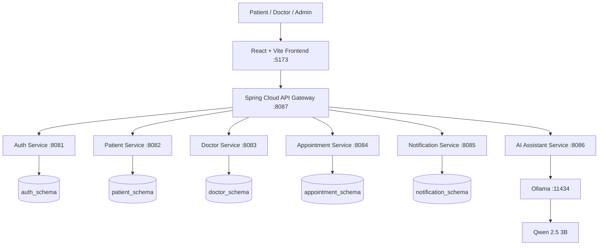

<div align="center">

<div align="center">

# 🏥 CareFlow AI

### AI-Powered Healthcare Service Management Platform

**Java Full Stack | Spring Boot Microservices | React | MySQL | Ollama AI**

[](https://www.java.com/)
[](https://spring.io/projects/spring-boot)
[](https://react.dev/)
[](https://www.mysql.com/)
[](https://ollama.com/)

</div>
# CareFlow AI
### AI-Powered Healthcare Service Management Platform

A full-stack healthcare management platform built with **Java, Spring Boot Microservices, React, MySQL, JWT Authentication, and Local AI using Ollama**.

[](https://www.java.com/)
[](https://spring.io/projects/spring-boot)
[](https://react.dev/)
[](https://www.mysql.com/)
[](https://ollama.com/)

</div>

---

## 📌 Table of Contents

1. Project Overview
2. Key Features
3. Technology Stack
4. System Architecture
5. Project Structure
6. Installation and Setup
7. API Gateway and Service Ports
8. Database Design
9. AI Assistant - Ollama + Qwen
10. Testing
11. Screenshots
12. Future Enhancements
13. Author

---

## 1. Project Overview

**CareFlow AI** is a healthcare service management platform designed to simplify interactions between patients, doctors, and administrators.

Patients can register, browse doctors, book appointments, manage service requests, and receive notifications. Doctors can manage their profiles and availability. Administrators can oversee platform activities.

A local AI assistant provides general, non-diagnostic healthcare service guidance.

The application follows a **Microservices Architecture**, where each service is independently developed and communicates through a Spring Cloud API Gateway.

## 2. Key Features

### 🔐 Authentication and Security
- User registration and login.
- JWT-based authentication.
- Stateless request authentication.
- Role-based access for patients, doctors, and administrators.
- Password hashing using Spring Security.

### 👨‍⚕️ Patient Management
- Create and manage patient profiles.
- Retrieve patient information.
- Submit and track healthcare service requests.

### 🩺 Doctor Management
- Browse the doctor directory.
- View doctor details and specialization.
- Manage doctor profiles.
- Configure weekly availability.

### 📅 Appointment Management
- Select a doctor, visit type, date, and time slot.
- Book appointments.
- Prevent overlapping and duplicate bookings.
- Reschedule and cancel appointments.

### 🔔 Notification Management
- In-app notifications.
- Appointment-related notifications.
- View notification inbox.
- Track unread notifications.

### 🤖 AI Healthcare Assistant
- AI-powered healthcare assistant.
- Local AI integration using Ollama.
- Qwen 2.5 3B language model.
- No OpenAI API key required.
- General healthcare information and appointment guidance.
- Medical safety disclaimers.

---

## 3. Technology Stack

| Category | Technologies |
|---|---|
| Backend | Java 17, Spring Boot 3.4.5 |
| Microservices | Spring Cloud Gateway |
| Backend Architecture | Spring MVC, Spring Data JPA |
| Security | Spring Security, JWT, BCrypt |
| Frontend | React 19, Vite |
| Styling | Tailwind CSS |
| Database | MySQL |
| AI Integration | Spring AI, Ollama, Qwen 2.5 3B |
| API Testing | Postman |
| Build Tools | Maven, npm |
| IDE | Eclipse IDE, Visual Studio Code |
| Database Tool | MySQL Workbench |
| Deployment | Docker Compose, Nginx |

---

## 4. System Architecture

The React frontend communicates with the API Gateway. The gateway routes requests to the appropriate Spring Boot microservice.

Each service manages its own database.



### Microservices Responsibilities

| Service | Responsibility |
|---|---|
| API Gateway | Central API entry point and routing |
| Auth Service | Registration, login, JWT authentication |
| Patient Service | Patient profiles and service requests |
| Doctor Service | Doctor profiles and availability |
| Appointment Service | Appointment booking and management |
| Notification Service | In-app notifications |
| AI Assistant Service | Local AI healthcare assistant |

---

## 5. Project Structure

```text
healthcare-platform/
│
├── backend/
│   ├── api-gateway/
│   ├── auth-service/
│   ├── patient-service/
│   ├── doctor-service/
│   ├── appointment-service/
│   ├── notification-service/
│   └── ai-assistant-service/
│
├── frontend/
│   └── healthcare-ui/
│       ├── src/
│       ├── public/
│       ├── package.json
│       └── vite.config.js
│
├── database/
│   ├── MySQL schema scripts
│   └── sample data scripts
│
├── docker/
├── docs/
└── README.md
```

Each backend microservice follows a layered architecture:

```text
Controller
    |
    v
Service
    |
    v
Repository
    |
    v
Database
```

---

## 6. Installation and Setup

### Prerequisites

Install the following tools:

- JDK 17
- Maven
- Node.js and npm
- MySQL Server
- MySQL Workbench
- Eclipse IDE
- Visual Studio Code
- Ollama

### 6.1 Clone Repository

```bash
git clone https://github.com/Karankumarweb/ai-powered-healthcare-service-management-platform.git

cd ai-powered-healthcare-service-management-platform/healthcare-platform
```

### 6.2 Configure MySQL

Start MySQL Server and create the databases:

```sql
CREATE DATABASE auth_schema;
CREATE DATABASE patient_schema;
CREATE DATABASE doctor_schema;
CREATE DATABASE appointment_schema;
CREATE DATABASE notification_schema;
```

Run the corresponding SQL schema and sample-data scripts from the `database/` directory.

Configure database credentials in your service configuration or environment variables:

```properties
MYSQL_HOST=localhost
MYSQL_PORT=3306
MYSQL_USER=root
MYSQL_PASSWORD=your_mysql_password
```

**Important:** Never upload your actual database password to GitHub.

### 6.3 Configure JWT

Configure the same `JWT_SECRET` for Auth Service, API Gateway, and all services that validate JWT tokens.

```properties
JWT_SECRET=your_base64_encoded_secret
JWT_ACCESS_EXPIRATION_MS=900000
JWT_REFRESH_EXPIRATION_MS=604800000
```

Keep your JWT secret private.

### 6.4 Configure Ollama Local AI

Install Ollama:

https://ollama.com/

Download the Qwen model:

```bash
ollama pull qwen2.5:3b
```

Check installed models:

```bash
ollama list
```

Ollama API:

```text
http://localhost:11434
```

The AI Assistant Service uses:

```yaml
spring:
  ai:
    ollama:
      base-url: http://localhost:11434
      chat:
        options:
          model: qwen2.5:3b
          temperature: 0.3
```

No OpenAI API key is required for this local Ollama integration.

### 6.5 Start Backend Microservices

Import all seven Maven projects from the `backend/` directory into Eclipse.

Configure the required environment variables in each Run Configuration.

Start the services in this order:

1. Auth Service
2. Patient Service
3. Doctor Service
4. Appointment Service
5. Notification Service
6. AI Assistant Service
7. API Gateway

You can use Eclipse **Run Configurations → Launch Group** to start the backend services together after configuring the individual Java Application configurations.

If a service is already running, stop its existing instance before starting it again to avoid port conflicts.

### 6.6 Start React Frontend

Open a terminal inside:

```text
frontend/healthcare-ui
```

Install dependencies:

```bash
npm install
```

Start the Vite development server:

```bash
npm run dev
```

Open the application:

```text
http://localhost:5173
```

The local Vite development configuration should proxy `/api` requests to the API Gateway at `http://localhost:8087`.

---

## 7. API Gateway and Service Ports

| Component | Local Port |
|---|---:|
| React Frontend | 5173 |
| Auth Service | 8081 |
| Patient Service | 8082 |
| Doctor Service | 8083 |
| Appointment Service | 8084 |
| Notification Service | 8085 |
| AI Assistant Service | 8086 |
| API Gateway | 8087 |
| Ollama | 11434 |
| MySQL | 3306 |

### Health Check

Check AI Assistant Service:

```text
http://localhost:8086/actuator/health
```

Expected response:

```json
{
  "status": "UP"
}
```

API Gateway:

```text
http://localhost:8087
```

---

## 8. Database Design

The local development setup uses separate MySQL databases for service data ownership.

| Database | Purpose |
|---|---|
| auth_schema | Users, roles, authentication data |
| patient_schema | Patient profiles and service requests |
| doctor_schema | Doctor profiles and availability |
| appointment_schema | Appointment records |
| notification_schema | In-app notifications |

Microservices communicate through REST APIs for cross-service operations.

---

## 9. AI Assistant - Ollama + Qwen

CareFlow AI integrates a local AI assistant using **Spring AI + Ollama + Qwen 2.5 3B**.

### AI Architecture

```text
React Chatbot
     |
     v
API Gateway
     |
     v
AI Assistant Service
     |
     v
Spring AI
     |
     v
Ollama Local API
     |
     v
Qwen 2.5 3B
     |
     v
AI Response
```

### Benefits of Local AI

- No OpenAI API key required.
- No OpenAI API credits required.
- Runs using a locally downloaded model.
- Works without internet after model download.
- Provides healthcare service guidance.

**Medical Disclaimer:** The AI assistant provides informational guidance only. It does not diagnose diseases, prescribe medication, or replace licensed medical professionals. For emergencies, contact local emergency services.

---

## 10. Testing

Manual testing checklist:

- [ ] MySQL Server is running.
- [ ] Ollama is running.
- [ ] Qwen 2.5 3B model is available.
- [ ] All backend services start successfully.
- [ ] API Gateway is accessible.
- [ ] Frontend opens successfully.
- [ ] User registration works.
- [ ] User login works.
- [ ] Doctor listing works.
- [ ] Appointment booking works.
- [ ] Notifications work.
- [ ] AI chatbot returns responses.

Run backend tests from an individual service directory:

```bash
mvn test
```

---

## 11. Screenshots

Add your actual application screenshots in:

```text
docs/screenshots/
```

Example:

```markdown


```

Recommended screenshots:

- Login and Registration
- Patient Dashboard
- Doctor Directory
- Appointment Booking
- Notification Center
- AI Assistant Chatbot

---

## 12. Future Enhancements

- Automated integration and end-to-end testing.
- CI/CD pipeline using GitHub Actions.
- Centralized logging and distributed tracing.
- Email and SMS notifications.
- Automated appointment reminders.
- Telehealth integration.
- Billing and payment management.
- Production deployment and monitoring.

---

## 13. Author

<div align="center">

# Karan Kumar

### Java Full Stack Developer

[](https://github.com/Karankumarweb)

**Project Repository**

[AI-Powered Healthcare Service Management Platform](https://github.com/Karankumarweb/ai-powered-healthcare-service-management-platform)

---

### CareFlow AI

**Making Healthcare Service Management Simpler and Smarter.**

</div>
