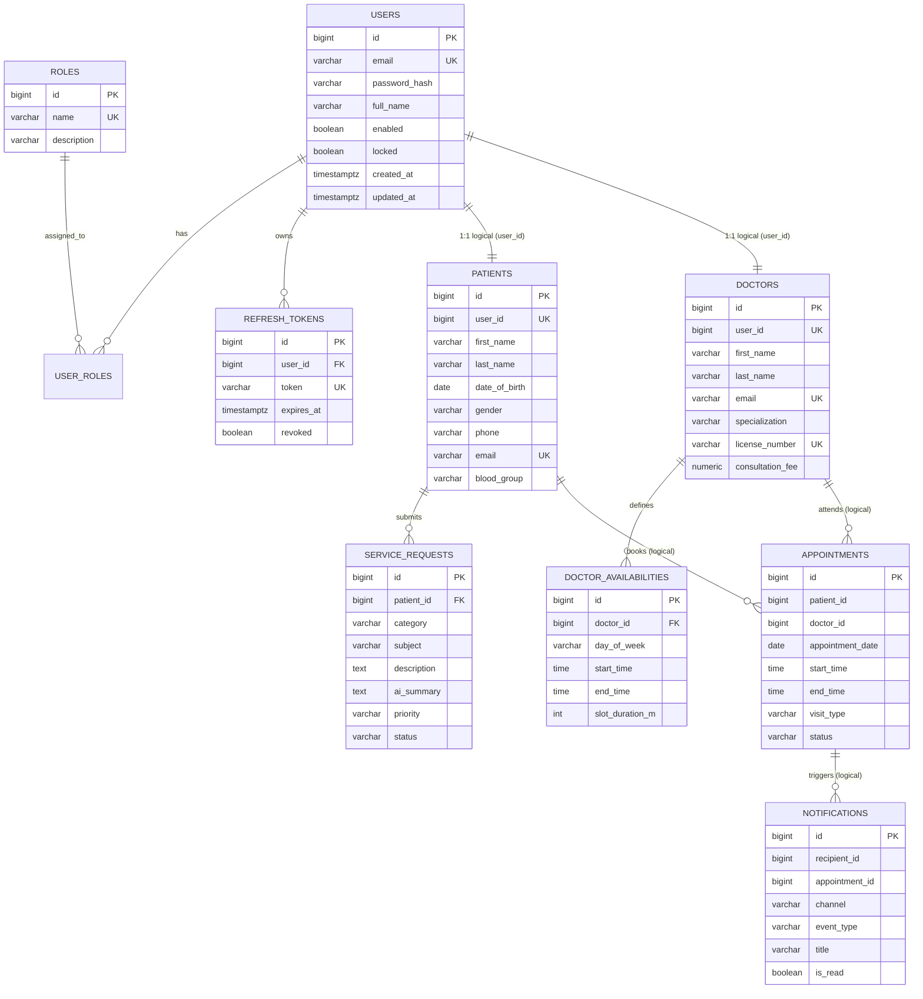

# Database Design — AI-Powered Healthcare Service Management Platform

## 1. Schema-per-Service Strategy

In a microservices architecture, services must not couple directly via cross-service foreign keys at the database table level. Instead, we use **one PostgreSQL 16 instance** (`healthcare_platform`) with **5 isolated schemas**:

- `auth_schema` (owned by `auth-service`)
- `patient_schema` (owned by `patient_schema` / `patient-service`)
- `doctor_schema` (owned by `doctor-service`)
- `appointment_schema` (owned by `appointment-service`)
- `notification_schema` (owned by `notification-service`)

Cross-service relationships (such as `appointments.patient_id` or `patients.user_id`) are stored as **logical IDs** validated via REST API calls rather than hard SQL foreign keys across schemas, keeping each service independently deployable.

## 2. Entity-Relationship Diagram (Mermaid)



## 3. Double-Booking Prevention Design

1. **Application-level Overlap Query (JPQL)**: Before saving an appointment, `appointment-service` queries any existing active appointment for the same `doctor_id` and `appointment_date` where `(existing.start_time < newEndTime AND existing.end_time > newStartTime)`.
2. **Database-level Partial Unique Index**:
   ```sql
   CREATE UNIQUE INDEX uq_doctor_active_slot
   ON appointment_schema.appointments (doctor_id, appointment_date, start_time)
   WHERE status IN ('SCHEDULED', 'CONFIRMED', 'RESCHEDULED');
   ```
   This guarantees race conditions cannot insert two active bookings for the same start slot even under concurrent requests.
